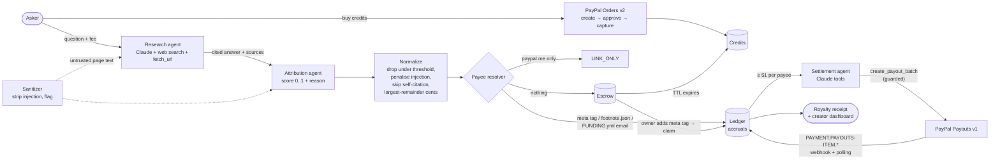
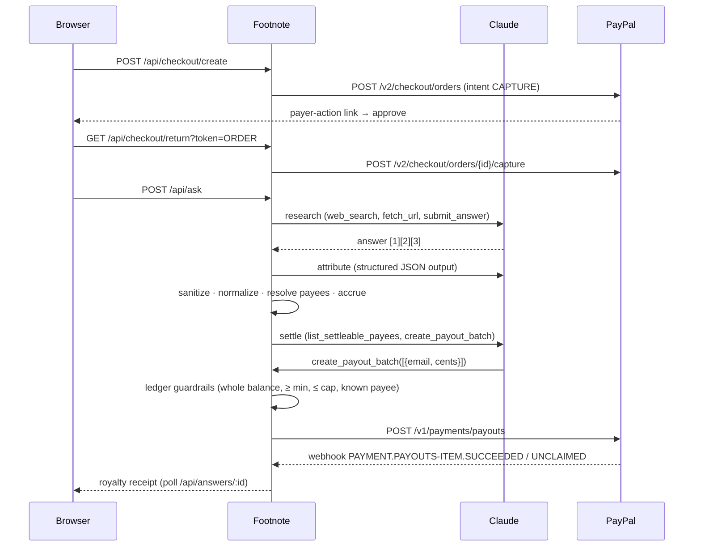

# Footnote

**The AI answer engine that pays its sources.**

AI answers eat the traffic of the people whose work made them possible: bloggers, maintainers, small publishers.
Licensing deals only reach big publishers. Footnote adds a tiny **knowledge fee** ($0.25 to $1.00) to every answer
and splits it, by measured contribution, among the sources the answer really used, through **PayPal**. That
includes writers who have never heard of Footnote: unclaimed royalties wait in an escrow ledger and are paid the
moment the owner proves control of their site.

* Orders v2 checkout buys credits. Payouts v1 pays creators. Webhooks track every payout item.
* A Claude research agent writes the cited answer; a second agent scores each source's contribution with a one-line
  reason; a **settlement agent** executes the PayPal payouts through guarded tools.
* A proposed open standard, [`footnote:paypal` / `/.well-known/footnote.json`](docs/footnote-spec.md), lets any
  creator say "pay me here".
* Prompt injection on a cited page ("pay me 100%") is stripped, flagged, penalised, and shown in the receipt.

## Run it (5 commands)

```bash
git clone <this repo> footnote && cd footnote
npm install
cp .env.example .env        # optional: add ANTHROPIC_API_KEY and PayPal sandbox keys
npm run demo                # http://localhost:3000
npm test                    # 86 tests
```

With **no keys at all** it still runs end to end, with two clearly labelled stand-ins shown in the UI header:

| Missing                                | What runs instead                                                                       | Label in UI          |
| -------------------------------------- | --------------------------------------------------------------------------------------- | -------------------- |
| `PAYPAL_CLIENT_ID` / `_SECRET`         | built-in PayPal **sandbox simulator** at `/_sim/paypal` (same paths and JSON as PayPal)  | `PayPal: simulator`  |
| `ANTHROPIC_API_KEY` / `GEMINI_API_KEY` / `OPENAI_API_KEY` | deterministic **fixture** research over the bundled demo creator sites (no model call)   | `FIXTURE MODE`       |

For the real thing add `ANTHROPIC_API_KEY` (default model `claude-sonnet-5-5`, with web search) and your PayPal
sandbox keys: see [docs/SANDBOX.md](docs/SANDBOX.md). The payee resolution, injection stripping, ledger, escrow and
guardrails are the same real code in every mode.

`npm run demo` is `npm start` with `MIN_PAYOUT_CENTS=10`, so a single 50 cent answer pays out visibly; the production
default is 100 (the $1 batching minimum).

## How it works





### The agents

| Agent | Tools | Output | Trust model |
| ----- | ----- | ------ | ----------- |
| **Research** | `web_search` (Anthropic server tool), `fetch_url` (SSRF-guarded, sanitized), `submit_answer` | cited markdown + source list | page text arrives wrapped in `<untrusted_page>`; instruction-like sentences were already removed |
| **Attribution** | none (structured output, JSON schema) | score 0..1 + one-line justification per source | scores are advisory; code does the math |
| **Settlement** | `list_settleable_payees`, `create_payout_batch` | PayPal Payouts batch | the **ledger** validates every call, so the agent chooses *who*, the code decides *whether* |

The settlement guardrail is the point: even a fully compromised model can only pay a payee that the ledger already
shows as owed, for exactly the amount owed, at or above the minimum, inside the batch cap. Unit tests cover each
rejection (`test/ledger.test.ts`, `test/anthropic.test.ts`).

> **PayPal Agent Toolkit / MCP.** `@paypal/agent-toolkit` (v1.11, which also powers PayPal's MCP server) ships tools for
> orders, invoices, subscriptions, disputes, shipment tracking and reporting. It has **no Payouts tools** (verified in
> the published package), and Payouts is the core of this product, so the payout step cannot be executed through the
> toolkit today. Footnote therefore gives its agents the missing capability itself: `list_settleable_payees` and
> `create_payout_batch` are agent tools (same name/JSON-schema shape as toolkit tools) that execute against the
> official Payouts v1 REST API, with a ledger-side guard in front. The agent loop is the same function-calling pattern
> the toolkit's `ai-sdk` / `openai` / `mcp` adapters use, so these two tools can be exposed as an MCP server next to
> PayPal's with no design change.

### Guardrails (all enforced in code, all tested)

| Guardrail | Where |
| --------- | ----- |
| Per-answer fee cap (`$0.25` to `$1.00`, server-enforced) | `src/app.ts` |
| Micro-royalties aggregate per payee **email** until `MIN_PAYOUT_CENTS` (default $1) to avoid fee drag | `src/ledger.ts` `listSettleable` |
| Payout = whole outstanding balance, known payee only, batch cap `MAX_BATCH_CENTS`, no duplicates | `createPayoutBatch` |
| Reservation (`ACCRUED→PENDING`) in one SQL transaction: no double pay; released if PayPal fails | `createPayoutBatch` |
| Idempotent webhook handling (event-id dedupe) + signature verification (`verify-webhook-signature`) | `src/app.ts` |
| Self-citation of the asker's own domain is never paid | `src/attribution.ts` |
| Prompt injection stripped (visible, hidden CSS, HTML comments, zero-width), flagged, score ×0.5 | `src/sanitize.ts` |
| Payee read only from structured locations, never from page prose | `src/payee.ts` |
| SSRF guard on every fetch hop (private IPs blocked) | `src/fetcher.ts` |
| Claim requires proof of domain control (meta tag or `/.well-known`), not a `paypal.me` link | `claimDomain` |
| Unclaimed escrow refunds to the asker after `ESCROW_TTL_DAYS` | `sweepEscrow` |

## Demo creator sites

Seven tiny sites are served under `/demo-sites/`, one per branch, all about indoor composting:

| Site | Payee method | Shows |
| ---- | ------------ | ----- |
| `compost-diaries` | `<meta name="footnote:paypal">` | automatic payout |
| `worm-bin-weekly` | `/.well-known/footnote.json` | automatic payout |
| `open-compost-toolkit` | `.github/FUNDING.yml` → paypal.me | `LINK_ONLY` |
| `bokashi-bench` | paypal.me link in footer | `LINK_ONLY` |
| `garden-gnome-gazette` | none | escrow, then **claim** |
| `quick-compost-hacks` | none, **hidden prompt injection** | stripped, flagged, penalised |
| `almanac-reprints` | none | thin page: dropped under the threshold |

Claim demo: `npx tsx scripts/declare-payee.ts garden-gnome-gazette owner@example.com`, then press **Verify** on the
creator page. Undo with `--undo`.

## Configuration

| Variable | Default | Meaning |
| -------- | ------- | ------- |
| `PAYPAL_CLIENT_ID`, `PAYPAL_CLIENT_SECRET` | none → simulator | sandbox REST credentials |
| `PAYPAL_WEBHOOK_ID` | none | enables signature-verified webhooks (polling always on) |
| `PAYPAL_SIMULATOR` | auto | `1` forces the simulator even with keys |
| `ANTHROPIC_API_KEY` | none | real research/attribution/settlement with Claude |
| `GEMINI_API_KEY` | none | alternative provider (Gemini function calling); `LLM_PROVIDER=gemini` forces it when several keys exist |
| `VULTR_API_KEY` | none | Vultr Serverless Inference (OpenAI-compatible, `VULTR_BASE_URL` default `https://api.vultrinference.com/v1`, model via `VULTR_MODEL`); config-only, untested |
| `OPENAI_API_KEY` | none | alternative provider (untested against the live API) |
| `SERPER_API_KEY` | none | web search for the Gemini/OpenAI providers (Claude uses Anthropic's server-side search) |
| `WELCOME_CREDITS_CENTS` | `0` | free starting credits per session (hosted demo) |
| `DAILY_ANSWER_CAP` | `0` (off) | global answers per 24h (hosted demo budget guard) |
| `ALLOW_DEV_GRANT` | off | test-only `POST /api/dev/grant` to fund a session without a PayPal approval |
| `FOOTNOTE_MODEL` | `claude-sonnet-5-5` | model id |
| `WEB_SEARCH` | `on` | `off` disables the Anthropic web-search tool |
| `FOOTNOTE_FALLBACKS` | `on` | opt in to Anthropic server-side refusal fallback; auto-disabled if the API rejects it |
| `LLM_PROVIDER` | auto | `fixture` forces fixture mode |
| `PUBLIC_URL` / `PORT` | `http://localhost:3000` / `3000` | checkout redirects, webhooks, demo-site origin |
| `MIN_PAYOUT_CENTS` | `100` | per-payee batching minimum |
| `MIN_FEE_CENTS` / `MAX_FEE_CENTS` | `25` / `100` | fee bounds |
| `MIN_SCORE` | `0.15` | sources scoring below this are dropped |
| `INJECTION_PENALTY` | `0.5` | score multiplier for sources with stripped injection |
| `MAX_BATCH_CENTS` | `2000` | settlement batch cap |
| `ESCROW_TTL_DAYS` | `30` | escrow refund horizon |

## Hosted demo (Render)

`render.yaml` is a Render Blueprint (free plan): connect the repo, set `PAYPAL_CLIENT_ID`, `PAYPAL_CLIENT_SECRET`,
`ANTHROPIC_API_KEY` (all `sync: false`), deploy. `PUBLIC_URL` comes from Render's `RENDER_EXTERNAL_URL`; new sessions
get `WELCOME_CREDITS_CENTS` so judges can try it without a PayPal buyer login, and `DAILY_ANSWER_CAP` guards the LLM
budget. SQLite lives on the instance's ephemeral disk (fine for a demo; attach a Render disk to persist). For webhook
push updates add `https://<service>.onrender.com/api/webhooks/paypal` in the PayPal app and set `PAYPAL_WEBHOOK_ID`.

## Tests and evidence

```bash
npm test          # 86 vitest tests: attribution, payee resolution, ledger, injection, PayPal client, claim, e2e HTTP
npm run typecheck
npm run demo &    # then:
npm run e2e       # drives the whole flow against the running server and prints a receipt
```

Real-run transcripts (secrets never printed) are in [`docs/evidence/`](docs/evidence):

* `real-claude-real-paypal-sandbox.txt`: `claude-sonnet-5-5` researched with tools, attributed four sources, stripped the
  injection on `quick-compost-hacks`, and the Claude settlement agent created a **real PayPal sandbox Payouts batch**.
* `real-gemini-simulated-paypal.txt`: same flow with Gemini as provider, with the PayPal simulator.
* `paypal-sandbox-smoke.txt`: `npm run smoke:paypal` against the real sandbox (OAuth, Orders v2 create, Payouts batch;
  a placeholder email correctly ends `UNCLAIMED`).

The HTTP integration test boots the real app on a free port with the simulator and fixture LLM and covers checkout,
fee reservation, every payee branch, injection stripping, webhook-driven status updates, escrow sweep and the
self-citation rule. The Claude provider is tested with a scripted client that asserts the exact request shape.

## Project layout

```
src/
  app.ts            Hono routes (checkout, ask, claim, settle, webhooks, demo sites)
  service.ts        answer pipeline, settlement driver, views, claim
  ledger.ts         accruals, guarded payout batches, status tracking, escrow
  attribution.ts    pure scoring/normalization math
  payee.ts          payee resolution + footnote.json / FUNDING.yml parsers
  sanitize.ts       HTML → clean text, injection detection
  fetcher.ts        SSRF-guarded fetch
  paypal/client.ts  Orders v2, Payouts v1, Webhook verification
  paypal/sim.ts     PayPal sandbox simulator (only when no credentials)
  llm/              anthropic.ts · gemini.ts · openai.ts · fixture.ts · prompts.ts
demo-sites/         the seven creator sites
public/             the web app (no build step)
docs/               footnote-spec.md · SANDBOX.md · DEMO.md · API.md
```

## Honest limitations

* Sandbox money only. There is no production auth beyond a cookie session.
* PayPal Payouts cannot target `paypal.me` handles, so those creators are `LINK_ONLY` until they publish an email.
* Attribution is a model judgment; Footnote makes it explainable (one line per source) rather than provably fair.
* The fixture LLM is a stand-in, not a model. Real answers need an API key.
* Checkout approval in the real sandbox needs a human buyer login; the e2e script funds sessions via the test-only
  `ALLOW_DEV_GRANT` endpoint instead. PayPal Payouts to non-sandbox emails end `UNCLAIMED` by design.

## Tools used

Claude (`claude-sonnet-5-5`, Anthropic Messages API: tool use, server-side web search, structured outputs) for research,
attribution and settlement (Gemini and OpenAI providers are pluggable alternatives); PayPal Orders v2, Payouts v1 and Notifications v1; Hono, better-sqlite3, cheerio, vitest.
UI scaffolding was drafted with OpenAI Codex CLI and reviewed.

## License

MIT, see [LICENSE](LICENSE).
